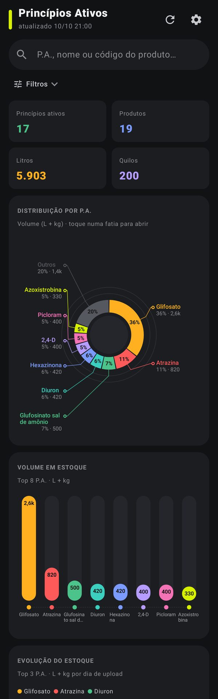
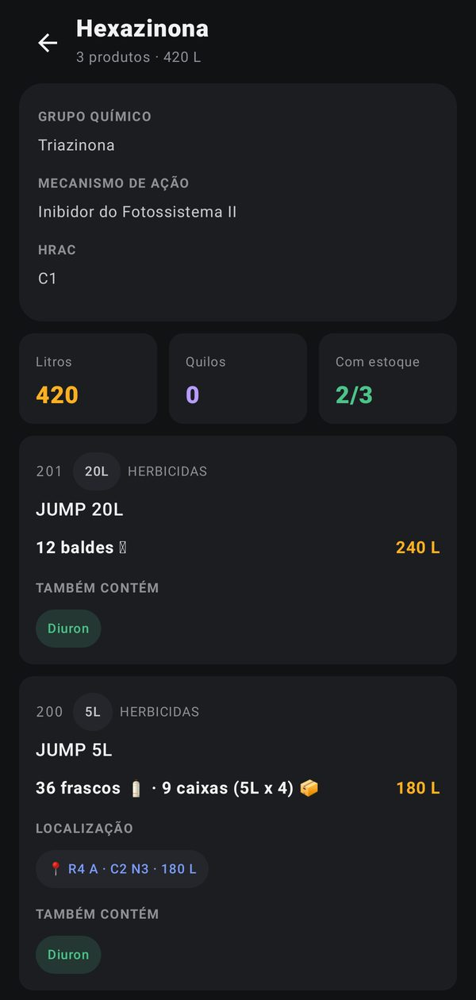
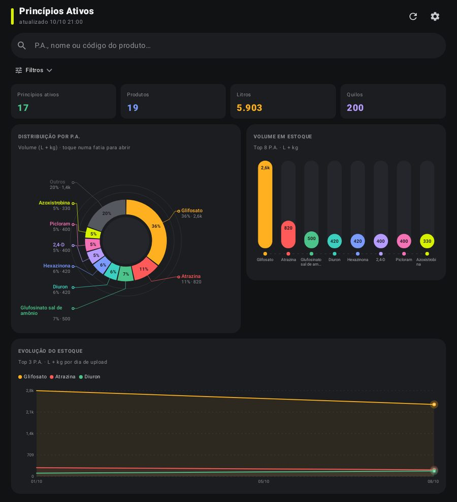

# Princípio Ativo — CAMDA

App Android de consulta do estoque CAMDA agrupado por **princípio ativo (P.A.)**.
Lê o mesmo banco Turso do [camda-estoque](https://github.com/LeoLira1/camda-estoque), só leitura.

## Baixar o APK

**[⬇️ principio-ativo.apk (última versão)](https://github.com/LeoLira1/Principioativo/releases/latest/download/principio-ativo.apk)**

No celular: abra o link, baixe e toque no arquivo. O Android vai pedir para
permitir "instalar apps desconhecidos" para o navegador — é só autorizar.

## Primeiro acesso

O app pede a **URL do banco** (`libsql://…turso.io`) e um **token** criado só para ele:

```bash
turso db tokens create <nome-do-banco>               # consulta + cadastro de P.A.
turso db tokens create <nome-do-banco> --read-only   # só consulta
```

O app só escreve numa tabela (`principios_ativos`), e só quando você salva um cadastro.

Os dois ficam cifrados no aparelho (EncryptedSharedPreferences). Não há
credencial no código nem no APK. Em ⚙️ dá para desconectar e apagar tudo.

## O que tem

Dois setores, trocados no topo da tela:

- **🌾 Barracão**: herbicidas, fungicidas, inseticidas e nematicidas, agrupados por P.A.,
  estoque em litros/kg e na unidade física.
- **💊 Loja Vet**: medicamentos veterinários (grupos de medicamento do BI + códigos com
  classe em `classificacao_vet`), agrupados por **classe terapêutica** ou por **P.A.**,
  estoque em unidades, filtro por espécie.

Adubos, adjuvantes, sementes, rações etc. não entram em nenhum dos dois.


- **Vincular P.A. (botão ➕ no topo)**: busca inteligente em TODOS os produtos do estoque (qualquer setor/categoria), sem acento, fora de ordem e com erro de digitação; toque no produto e cadastre o P.A.
- **Busca única**: P.A., nome ou código, parcial, sem diferenciar maiúsculas nem acentos.
- **Rosca segmentada** (top 8 + "Outros"), com % na fatia e linha-guia até o rótulo.
- **Barras em pílula** com trilho e valor no topo (top 8 por volume).
- **Evolução do estoque** (linhas), a partir dos snapshots de `vendas_historico` (últimos 180 dias).
- **Lista de P.A.**: contagem de produtos e volume total, mais o grupo **Sem P.A. cadastrado**.
- **Detalhe do P.A.**: código, nome, embalagem, estoque em litros e na unidade física,
  localização do Mapa de Estoque e os outros P.A. das misturas como etiquetas (toque para abrir).
- **Cadastro de P.A. de produto novo**: o produto que chega e não casa com a base aparece
  em **Sem P.A. cadastrado** → *Cadastrar P.A.* (com sugestões; misturas um ingrediente por
  vez). Também dá para *Editar P.A.* em qualquer produto. Grava em `principios_ativos` do
  mesmo jeito que o dashboard (vale lá também). Precisa de token **com escrita**.
- **Filtros** recolhíveis (estoque, embalagem, categoria) que atuam juntos e atualizam os gráficos.
- Funciona offline com a última leitura salva. Layout de celular e de tablet.

### Conversão de embalagem

| Embalagem | Mostra |
|---|---|
| 1L | unidades 🧴 |
| 5L | frascos e caixas (5L x 4) 📦 |
| 10L | galões soltos |
| 20L | baldes 🪣 (cada unidade já é 1 balde) |
| nXm (ex.: 4X5L) | caixas = litros ÷ (n × m) |
| kg / outros volumes | unidades da embalagem + kg/L |

A embalagem vem do nome do produto (o banco não tem coluna própria), com as
mesmas regras de `extrair_litros`/`extrair_kg` do dashboard.

## De onde vem cada dado

| Dado | Tabela |
|---|---|
| Produto, código, categoria, estoque | `estoque_mestre` (`qtd_sistema`) |
| P.A. | `principios_ativos`, casado por nome com o mesmo algoritmo da aba 🧬 do dashboard |
| Localização | `mapa_posicoes` + `mapa_produtos` / `mapa_produtos_codigos` (por código, fallback nome) |
| Histórico | `vendas_historico.qtd_estoque` por dia de upload |
| Grupo químico / mecanismo / HRAC | `produtos_CAMDA.xlsx`, embarcado em `app/src/main/assets/catalogo_pa.json` |

## Telas (dados de exemplo)

<p>


</p>


## Desenvolvimento

```bash
./gradlew testDebugUnitTest   # testes de busca, misturas, sem P.A., embalagens, filtros, parser
./gradlew assembleRelease     # app/build/outputs/apk/release/app-release.apk
```

Publicar uma versão: todo push na `main` (ou **Actions → Android → Run workflow**)
roda os testes, gera o APK e cria o Release `v1.0.<n>` com ele. Uma tag `v*`
empurrada à mão também publica, com o número da tag.

### Assinatura (opcional, recomendado)

Sem configuração, o APK sai assinado com a chave de debug do runner, que muda a
cada build: para atualizar, desinstale a versão anterior. Para atualizar por
cima, crie uma chave uma vez e cadastre como secrets do repositório
(`PA_KEYSTORE_BASE64`, `PA_KEYSTORE_PASSWORD`, `PA_KEY_ALIAS`, `PA_KEY_PASSWORD`):

```bash
keytool -genkeypair -v -keystore pa.jks -alias pa -keyalg RSA -keysize 2048 -validity 10000
base64 -w0 pa.jks   # conteúdo do secret PA_KEYSTORE_BASE64
```
